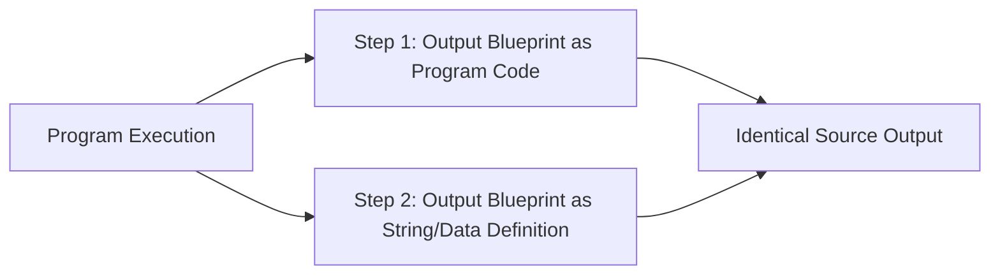
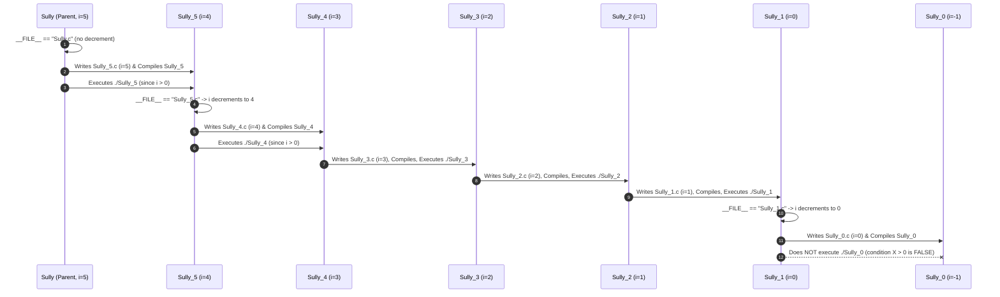

# Dr_Quine

> *A self-reproducing computer program (quine) exploration based on Kleene's Recursion Theorem.*

---

## Table of Contents
1. [Theoretical Background](#theoretical-background)
   - [What is a Quine?](#what-is-a-quine)
   - [Kleene's Recursion Theorem & Fixed Points](#kleenes-recursion-theorem--fixed-points)
   - [Quine Architecture: Blueprint vs. Builder](#quine-architecture-blueprint-vs-builder)
   - [Compiler Escape Sequences & The Quine Paradox](#compiler-escape-sequences--the-quine-paradox)
2. [Quine Implementation Paradigms in C](#quine-implementation-paradigms-in-c)
   - [Paradigm 1: The Character-Escaping Loop (Dynamic Escaper)](#paradigm-1-the-character-escaping-loop-dynamic-escaper)
   - [Paradigm 2: Array of String Slices (The Thompson / Kernighan Method)](#paradigm-2-array-of-string-slices-the-thompson--kernighan-method)
   - [Paradigm 3: Sequential Format Arguments (Standard `printf`)](#paradigm-3-sequential-format-arguments-standard-printf)
   - [Paradigm 4: Numeric ASCII Byte Array (Pure Decimal Encoding)](#paradigm-4-numeric-ascii-byte-array-pure-decimal-encoding)
   - [Paradigm 5: Positional Parameter Referencing (`%1$c`)](#paradigm-5-positional-parameter-referencing-1c)
   - [Paradigm Comparison Matrix](#paradigm-comparison-matrix)
3. [Project Structure](#project-structure)
4. [Program Specifications & Implementations](#program-specifications--implementations)
   - [1. Colleen (C & ASM)](#1-colleen-c--asm)
   - [2. Grace (C & ASM)](#2-grace-c--asm)
   - [3. Sully (C & ASM)](#3-sully-c--asm)
5. [Sully Metamorphic Execution Flow](#sully-metamorphic-execution-flow)
6. [Compilation & Build Rules](#compilation--build-rules)
7. [Automated Testing & Verification](#automated-testing--verification)

---

## Theoretical Background

### What is a Quine?
A **quine** is a computer program that takes no input and produces a copy of its own source code as its only output. 

> [!WARNING]
> - Opening the source file directly (e.g., using `open("Colleen.c")` or `cat`) is considered cheating.
> - Inspecting command-line argument pointers such as `argv` or environment vectors is strictly forbidden.
> - The program must independently reconstruct its entire source text from its internal data representation and execution logic.

### Kleene's Recursion Theorem & Fixed Points
In mathematical logic and computability theory, **Stephen Cole Kleene's second recursion theorem** (1938) proves that for any computable function $F$, there exists a program index $e$ such that $F(e)$ computes the same function as $e$:
$$\phi_{F(e)} = \phi_e$$

In lambda calculus and computer science, this corresponds to finding a **fixed point** for program evaluation ($Y f = f (Y f)$). A quine is a concrete realization of Kleene's theorem: the program contains a data payload representing a blueprint of itself, and a code component that interprets that template and reproduces both the code and the data payload.



---

### Quine Architecture: Blueprint vs. Builder

Every classic quine consists of two cooperating logical parts:
1. **The Blueprint (Data Payload)**: A data structure containing a template of the entire source code, with placeholders for variable elements and for the data structure itself.
2. **The Builder (Execution Logic)**: A piece of code that outputs the blueprint twice:
   - First, as **executable program code** (outside the string literal / data assignment).
   - Second, as the **literal data definition itself** (inside `char *s = "...";` or `const char *s[] = {...};`).

---

### Compiler Escape Sequences & The Quine Paradox

A fundamental challenge in quine construction is the mismatch between source text and runtime memory representation:

#### 1. Source Representation vs. Runtime Memory
When the C compiler encounters an escape sequence inside double quotes (ISO/IEC 9899 §6.4.4.4):
- In the **source file** (`.c`), `\n` and `\"` are 2-byte sequences: backslash `\` followed by `n` or `"`.
- At **compile time**, the compiler translates them into raw single bytes in binary memory: `0x0A` (LF) and `0x22` (`"`).

When `printf("%s", s)` executes at runtime, it outputs the raw memory bytes:
- Every `\n` is output as a real byte `0x0A` (a literal line break).
- Every `\"` is output as a real byte `0x22` (an unescaped double quote `"`).

#### 2. The Multi-Line String Failure
If `s` contained `\n` and `\"`, then when `printf` prints the string definition (`char *s = "%s";`), the `%s` expansion outputs raw unescaped newlines:

```c
char *s = "/*
	This comment is outside the program.
*/
#include <stdio.h>
...
char *s = "
";
```

This output is **syntactically invalid C**:
1. In C, string literals **cannot span multiple lines with raw newlines** (the compiler halts with `error: missing terminating " character`).
2. An unescaped `"` prematurely terminates the string literal and triggers syntax errors on all subsequent tokens.

#### 3. Complete List of Escape Sequences Expanded by the Compiler

| Escape Sequence | Description | ASCII Value (Dec / Hex) | Quine Danger Level | Quine Behavior / Consequence |
|---|---|---|---|---|
| `\"` | **Double quote** | `34` / `0x22` | 🚨 **Critical** | Prematurely closes string literal; breaks compilation |
| `\n` | **Newline (LF)** | `10` / `0x0A` | 🚨 **Critical** | Splits string literal across lines; illegal in C syntax |
| `\\` | **Backslash** | `92` / `0x5C` | ⚠️ **High** | Becomes single `\` at runtime, causing diff mismatch |
| `\'` | Single quote | `39` / `0x27` | ⚠️ **Contextual** | Needs care when generating char literals like `'/'` |
| `\t` | Horizontal Tab | `9` / `0x09` | ℹ️ *Safe / Optional* | Literal tabs are valid inside C string literals |
| `\r` | Carriage Return (CR) | `13` / `0x0D` | ℹ️ Rare | Seldom used in modern Linux/Unix C sources |
| `\a` | Alert (Bell) | `7` / `0x07` | ℹ️ Rare | Audio bell; not relevant for source text |
| `\b` | Backspace | `8` / `0x08` | ℹ️ Rare | Control character |
| `\f` | Form Feed | `12` / `0x0C` | ℹ️ Rare | Page break character |
| `\v` | Vertical Tab | `11` / `0x0B` | ℹ️ Rare | Vertical spacing control |
| `\?` | Question mark | `63` / `0x3F` | ℹ️ Safe | Used to escape trigraphs (`??/`, etc.) |
| `\ooo` | Octal byte value | User-defined | N/A | Raw byte substitution |
| `\xhh` | Hexadecimal byte | User-defined | N/A | Raw byte substitution |

---

## Quine Implementation Paradigms in C

Several architectural approaches exist to solve the quine paradox:

---

### Paradigm 1: The Character-Escaping Loop (Dynamic Escaper)

#### Concept
Instead of relying on format specifiers, this approach stores the code as a string template containing a single sentinel character (e.g. `@` / ASCII `64`). A loop iterates over the template. Outside the sentinel, characters are printed normally. When the sentinel is encountered, an inner loop re-traverses the template and dynamically escapes problematic characters (`\n` $\rightarrow$ `\n`, `"` $\rightarrow$ `\"`, `\` $\rightarrow$ `\\`).

#### Working Example
```c
#include <stdio.h>

int main(void)
{
	char *s = "#include <stdio.h>\n\nint main(void)\n{\n\tchar *s = @;\n\tfor (int i = 0; s[i]; i++)\n\t{\n\t\tif (s[i] == 64)\n\t\t{\n\t\t\tputchar(34);\n\t\t\tfor (int j = 0; s[j]; j++)\n\t\t\t{\n\t\t\t\tif (s[j] == 10)\n\t\t\t\t\tprintf(\"%cn\", 92);\n\t\t\t\telse if (s[j] == 34)\n\t\t\t\t\tprintf(\"%c%c\", 92, 34);\n\t\t\t\telse if (s[j] == 92)\n\t\t\t\t\tprintf(\"%c%c\", 92, 92);\n\t\t\t\telse\n\t\t\t\t\tputchar(s[j]);\n\t\t\t}\n\t\t\tputchar(34);\n\t\t}\n\t\telse\n\t\t\tputchar(s[i]);\n\t}\n\treturn (0);\n}\n";
	for (int i = 0; s[i]; i++)
	{
		if (s[i] == 64)
		{
			putchar(34);
			for (int j = 0; s[j]; j++)
			{
				if (s[j] == 10)
					printf("%cn", 92);
				else if (s[j] == 34)
					printf("%c%c", 92, 34);
				else if (s[j] == 92)
					printf("%c%c", 92, 92);
				else
					putchar(s[j]);
			}
			putchar(34);
		}
		else
			putchar(s[i]);
	}
	return (0);
}
```

---

### Paradigm 2: Array of String Slices (The Thompson / Kernighan Method)

> [!NOTE]
> This is the paradigm used for all programs in this repository.

#### Concept
Originally popularized by Ken Thompson in his Turing Award lecture (*Reflections on Trusting Trust*), this paradigm stores the entire source code line-by-line in an array of string slices (`const char *s[]`). Because each line is an independent string literal, no newline characters exist inside any string! The program prints the initial lines, loops over the array to output the array definition with quotes and tabs, and then prints the remaining lines.

#### Working Example
```c
#include <stdio.h>

const char *s[] = {
	"#include <stdio.h>",
	"",
	"const char *s[] = {",
	"",
	"};",
	"",
	"int main(void)",
	"{",
	"	int i;",
	"	for (i = 0; i < 3; i++)",
	"		puts(s[i]);",
	"	for (i = 0; i < 24; i++)",
	"	{",
	"		putchar(9);",
	"		putchar(34);",
	"		fputs(s[i], stdout);",
	"		putchar(34);",
	"		putchar(44);",
	"		putchar(10);",
	"	}",
	"	for (i = 4; i < 24; i++)",
	"		puts(s[i]);",
	"	return (0);",
	"}",
};

int main(void)
{
	int i;
	for (i = 0; i < 3; i++)
		puts(s[i]);
	for (i = 0; i < 24; i++)
	{
		putchar(9);
		putchar(34);
		fputs(s[i], stdout);
		putchar(34);
		putchar(44);
		putchar(10);
	}
	for (i = 4; i < 24; i++)
		puts(s[i]);
	return (0);
}
```

---

### Paradigm 3: Sequential Format Arguments (Standard `printf`)

#### Concept
This method uses standard `printf` with basic `%c` and `%s` specifiers in strict left-to-right order without positional indices. Every newline and quote is represented by a `%c` argument passed sequentially. When condensed, this yields some of the shortest quines in existence.

#### Working Example
```c
#include <stdio.h>
int main(void){char*s="#include <stdio.h>%cint main(void){char*s=%c%s%c;printf(s,10,34,s,34,10);return 0;}%c";printf(s,10,34,s,34,10);return 0;}
```

---

### Paradigm 4: Numeric ASCII Byte Array (Pure Decimal Encoding)

#### Concept
This approach completely eliminates string literals and character escape issues by storing the entire source code as an array of raw integer ASCII values (`int s[] = {35, 105, 110, ...}`). The program outputs the characters using `putchar()` and reconstructs the array declaration by printing the integer values using `printf("%d, ", ...)`.

#### Working Example
```c
#include <stdio.h>

int main(void)
{
	int s[] = {35, 105, 110, 99, 108, 117, 100, 101, ... , 0};
	for (int i = 0; s[i]; i++)
	{
		if (s[i] == 64) /* ASCII 64 is sentinel '@' */
		{
			for (int j = 0; s[j]; j++)
				printf("%d, ", s[j]);
		}
		else
			putchar(s[i]);
	}
	return (0);
}
```

---

### Paradigm 5: Positional Parameter Referencing (`%1$c`)

#### Concept
Uses POSIX parameter formatting extensions (`%<n>$`). Argument 1 is newline (`10`), argument 2 is double quote (`34`), and argument 3 is the string itself (`s`). Because positional indices can be referenced repeatedly without consuming arguments sequentially, a single format string can reproduce any number of newlines with only three arguments passed to `printf`.

#### Working Example
```c
#include <stdio.h>

int main(void)
{
	char *s = "#include <stdio.h>%1$c%1$cint main(void)%1$c{%1$c%2$cchar *s = %2$c%3$s%2$c;%1$c%2$cprintf(s, 10, 34, s);%1$c%2$creturn (0);%1$c}%1$c";
	printf(s, 10, 34, s);
	return (0);
}
```

---

### Paradigm Comparison Matrix

| Paradigm | ANSI C Standard? | Loops Required? | Code Readability | Maintenance Complexity | Implementation Status |
|---|---|---|---|---|---|
| **1. Escaping Loop** | ✅ Yes | Yes | High | Low | Available alternative |
| **2. Array of Slices** | ✅ Yes | Yes | Very High | Medium (index tracking) | **Current Implementation (C & ASM)** |
| **3. Sequential `printf`** | ✅ Yes | No | Low | High (for multi-line) | Available alternative |
| **4. Numeric Array** | ✅ Yes | Yes | Low | High (requires generator) | Available alternative |
| **5. Positional Referencing** | ⚠️ POSIX only | No | Medium | Low | Available alternative |

---

## Project Structure

The project contains two distinct implementations fulfilling the mandatory specifications: one in **C** and one in **x86_64 Assembly (NASM)**, both built using **Paradigm 2 (Array of String Slices)**.

```
dr_quine/
├── Makefile             # Root Makefile orchestrating C and ASM builds & test suites
├── en.subject.pdf       # 42 Subject specification
├── README.md            # Comprehensive documentation
├── C/
│   ├── Makefile         # C build rules (all, clean, fclean, re)
│   ├── Colleen.c        # Quine with dual comments & auxiliary function (Paradigm 2)
│   ├── Grace.c          # Quine without declared main, 3 defines, 1 comment (Paradigm 2)
│   └── Sully.c          # Metamorphic quine decrementing integer counter (5 -> 0) (Paradigm 2)
└── ASM/
    ├── Makefile         # Assembly build rules (NASM + GCC linking)
    ├── Colleen.s        # x86_64 NASM quine with dual comments & auxiliary function (Paradigm 2)
    ├── Grace.s          # x86_64 NASM quine executed via macro, 3 defines, 1 comment (Paradigm 2)
    └── Sully.s          # x86_64 NASM metamorphic quine decrementing counter (5 -> 0) (Paradigm 2)
```

---

## Program Specifications & Implementations

### 1. Colleen (C & ASM)
- **Target Executable**: `Colleen`
- **Output**: Outputs exact source code to standard output (`stdout`).
- **Subject Constraints**:
  - Must define a `main` function.
  - Must contain at least two different comments:
    - One comment inside the `main` function.
    - One comment outside the program (global scope).
  - Must define and invoke an auxiliary function in addition to `main`.
- **Implementation Strategy (Paradigm 2 - Array of Slices)**:
  - **C ([C/Colleen.c](file:///mnt/projects/sne/Gohar/16.PROJECT_42/dr_quine/C/Colleen.c))**: Stores the entire program line-by-line in a `const char *s[]` array. The auxiliary function `print_source()` loops through the initial lines, iterates over the array to print each string slice wrapped in quotes and tabs using `putchar()` and `fputs()`, and then prints the closing lines. Zero escape sequences or positional specifiers are needed.
  - **ASM ([ASM/Colleen.s](file:///mnt/projects/sne/Gohar/16.PROJECT_42/dr_quine/ASM/Colleen.s))**: Stores each line as a null-terminated string slice in `.data lines:`. The procedure `print_source` loops through the string slices, outputs the header via `puts`, writes the slice declarations `\tdb %c%s%c, 0\n` using standard `printf`, and outputs the tail. `main` invokes `print_source`.

### 2. Grace (C & ASM)
- **Target Executable**: `Grace`
- **Output**: Writes its source code into a file named `Grace_kid.c` (or `Grace_kid.s` for assembly).
- **Subject Constraints**:
  - Strictly **no declared `main`** in regular source format.
  - Strictly **three preprocessor definitions** (`#define` / `%define` / `%macro`).
  - Strictly **one comment**.
  - Must run by **calling a macro**.
- **Implementation Strategy (Paradigm 2 - Array of Slices)**:
  - **C ([C/Grace.c](file:///mnt/projects/sne/Gohar/16.PROJECT_42/dr_quine/C/Grace.c))**:
    - Global array `const char *s[]` stores each program line.
    - Define 1: `#define FILENAME (char[]){71,114,97,99,101,95,107,105,100,46,99,0}` (avoids double quotes in string definition).
    - Define 2: `#define OUT(c) fputc(c, f)`
    - Define 3: `#define EXEC() int main(void) { ... }` (creates `main`, opens file, loops through slices, outputs array definition and tail, closes file).
    - Invoked at file scope via `EXEC()`.
  - **ASM ([ASM/Grace.s](file:///mnt/projects/sne/Gohar/16.PROJECT_42/dr_quine/ASM/Grace.s))**:
    - String slices stored consecutively in `.data lines:`.
    - Define 1: `%define FNAME 71, 114, 97, 99, 101, 95, 107, 105, 100, 46, 115, 0`
    - Define 2: `%define FLAGS 577`
    - Macro 3: `%macro RUN 0 ... %endmacro`
    - Concludes with the macro call `RUN`, expanding `main:` to open `Grace_kid.s` via `sys_open`, loop through slices with `dprintf`, and close via `sys_close`.
    - Stack alignment is maintained to 16 bytes per System V AMD64 ABI before variadic calls.

### 3. Sully (C & ASM)
- **Target Executable**: `Sully`
- **Behavior**:
  - Starts with an integer constant `i = 5`.
  - Introspects its source filename via the preprocessor macro `__FILE__` (avoiding forbidden `argv` usage).
  - Detects whether it is running as root `Sully` or a child `Sully_X`.
  - Decrements `i` for child instances (`5 -> 4 -> 3 -> 2 -> 1 -> 0`).
  - Writes a child source file `Sully_X.c` / `Sully_X.s` containing the updated integer.
  - Compiles the child source file into executable `Sully_X`.
  - Executes `./Sully_X` conditionally: only if the resulting counter $X > 0$.
  - Generates exactly 13 files when run from an external or parent location:
    - Root `Sully` executable
    - 6 child source files (`Sully_5` down to `Sully_0`)
    - 6 child binaries (`Sully_5` down to `Sully_0`)
- **Implementation Strategy (Paradigm 2 - Array of Slices)**:
  - **C ([C/Sully.c](file:///mnt/projects/sne/Gohar/16.PROJECT_42/dr_quine/C/Sully.c))**: Line 0 is `int i = 5;`. When writing `Sully_X.c`, line 0 is written dynamically using `fprintf(f, "int i = %d;\n", i);`. The rest of the program slices and array definitions are output via loops. Compiles child source files using `clang` (or fallback `gcc`) with `-Wall -Wextra -Werror`.
  - **ASM ([ASM/Sully.s](file:///mnt/projects/sne/Gohar/16.PROJECT_42/dr_quine/ASM/Sully.s))**: Line `i dd 5` is stored in `.data`. When writing `Sully_X.s`, line `i dd %d` is output with the updated counter. String searching uses `strstr` on `__FILE__`. Assembles with `nasm -f elf64` and links with `gcc -no-pie`, removing intermediate `.o` files.

---

## Sully Metamorphic Execution Flow

The self-spawning cycle of Sully executes according to the following state diagram:



---

## Compilation & Build Rules

### Root Makefile
The root Makefile delegates to the subdirectories and provides a top-level test runner:
```bash
make          # Builds both C and ASM programs
make c        # Builds C programs only
make asm      # Builds ASM programs only
make clean    # Cleans object files in C/ and ASM/
make fclean   # Removes all object files, executables, and child artifacts
make re       # Performs full fclean and rebuild
make test     # Runs end-to-end automated validation on all 6 programs
```

### Compiler & Assembler Flags
- **C Programs**: `clang -Wall -Wextra -Werror` (or `gcc` if `clang` is not present).
- **ASM Programs**: `nasm -f elf64` linked with `gcc -no-pie`.

---

## Automated Testing & Verification

Run the complete test suite with:
```bash
make test
```

### Manual Verification Steps (as specified in 42 Subject)

#### 1. Test Colleen (C):
```bash
cd C
gcc -Wall -Wextra -Werror Colleen.c -o Colleen
./Colleen > tmp_Colleen
diff -u Colleen.c tmp_Colleen # Zero differences expected
```

#### 2. Test Grace (C):
```bash
cd C
gcc -Wall -Wextra -Werror Grace.c -o Grace
./Grace
diff -u Grace.c Grace_kid.c   # Zero differences expected
```

#### 3. Test Sully (C):
```bash
mkdir -p /tmp/sully_c_eval && cd /tmp/sully_c_eval
gcc -Wall -Wextra -Werror <path_to>/dr_quine/C/Sully.c -o Sully
./Sully
ls -al | grep Sully | wc -l   # Exactly 13 files expected
diff <path_to>/dr_quine/C/Sully.c Sully_0.c # Only integer 5 vs 0 difference (1c1)
diff Sully_3.c Sully_2.c                     # Only integer 3 vs 2 difference (1c1)
```

#### 4. Test Assembly Programs (ASM):
```bash
cd ASM
make
./Colleen > tmp_Colleen && diff -u Colleen.s tmp_Colleen
./Grace && diff -u Grace.s Grace_kid.s
```
And similarly for `ASM/Sully.s` (where `diff Sully.s Sully_0.s` shows single-line evolution `10c10`).
