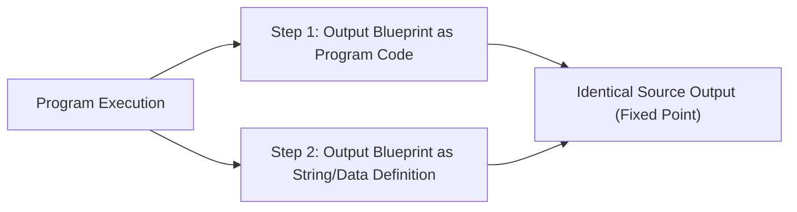
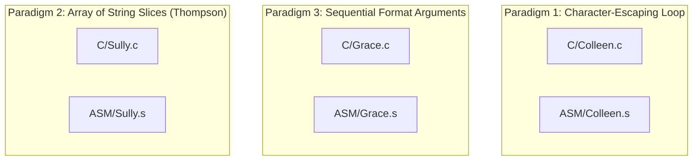
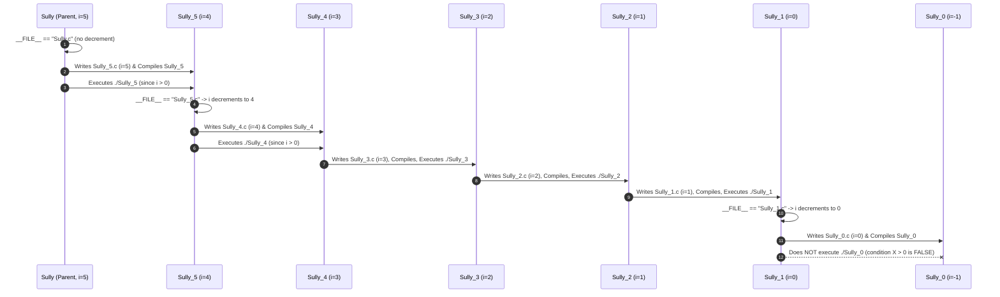

# Dr_Quine

> *A self-reproducing computer program (quine) exploration based on Kleene's Recursion Theorem and Fixed-Point Theory.*

---

## Table of Contents
1. [Theoretical Background](#theoretical-background)
   - [What is a Quine?](#what-is-a-quine)
   - [What Are Fixed Points? (Mathematics, Lambda Calculus & Quines)](#what-are-fixed-points-mathematics-lambda-calculus--quines)
   - [Kleene's Recursion Theorem](#kleenes-recursion-theorem)
   - [Quine Architecture: Blueprint vs. Builder](#quine-architecture-blueprint-vs-builder)
   - [Compiler Escape Sequences & The Quine Paradox](#compiler-escape-sequences--the-quine-paradox)
2. [Quine Implementation Paradigms in C](#quine-implementation-paradigms-in-c)
   - [Paradigm 1: The Character-Escaping Loop (Dynamic Escaper)](#paradigm-1-the-character-escaping-loop-dynamic-escaper)
   - [Paradigm 2: Array of String Slices (The Thompson / Kernighan Method)](#paradigm-2-array-of-string-slices-the-thompson--kernighan-method)
   - [Paradigm 3: Sequential Format Arguments (Standard `printf`)](#paradigm-3-sequential-format-arguments-standard-printf)
   - [Paradigm 4: Numeric ASCII Byte Array (Pure Decimal Encoding)](#paradigm-4-numeric-ascii-byte-array-pure-decimal-encoding)
   - [Paradigm 5: Positional Parameter Referencing (`%1$c`)](#paradigm-5-positional-parameter-referencing-1c)
   - [What "POSIX-Only" Means (ISO C vs. POSIX.1 XSI)](#what-posix-only-means-iso-c-vs-posix1-xsi)
   - [Paradigm Comparison Matrix](#paradigm-comparison-matrix)
3. [Project Structure](#project-structure)
4. [Program Specifications & Implementations](#program-specifications--implementations)
   - [Architectural Rationale: Why Each Paradigm Fits Its Program](#architectural-rationale-why-each-paradigm-fits-its-program)
   - [1. Colleen (C & ASM) — Paradigm 1](#1-colleen-c--asm--paradigm-1)
   - [2. Grace (C & ASM) — Paradigm 3](#2-grace-c--asm--paradigm-3)
   - [3. Sully (C & ASM) — Paradigm 2](#3-sully-c--asm--paradigm-2)
5. [Sully Metamorphic Execution Flow](#sully-metamorphic-execution-flow)
6. [Compilation & Build Rules](#compilation--build-rules)
7. [Automated Testing & Verification](#automated-testing--verification)

---

## Theoretical Background

### What is a Quine?
A **quine** (named by Douglas Hofstadter after the philosopher and logician Willard Van Orman Quine) is a computer program that takes no input and produces an exact copy of its own source code as its only output.

> [!WARNING]
> - Opening the source file directly from disk (e.g., using `open("Colleen.c")` or `cat`) is considered cheating.
> - Inspecting command-line argument pointers such as `argv` or environment vectors is strictly forbidden.
> - The program must independently reconstruct its entire source text from its internal data representation and execution logic.

---

### What Are Fixed Points? (Mathematics, Lambda Calculus & Quines)

The subject remarks: *"For the curious ones, I strongly recommend that you watch everything related to fixed points!"* Understanding fixed points reveals why quines are not merely a syntactic trick, but a fundamental property of any Turing-complete language.

#### 1. Fixed Points in Mathematics
Given a function $f: X \to X$, an element $x \in X$ is called a **fixed point** of $f$ if applying the function to $x$ leaves $x$ unchanged:
$$f(x) = x$$

- **Algebraic example**: For $f(x) = x^2$, the fixed points are $x = 0$ and $x = 1$, because $0^2 = 0$ and $1^2 = 1$.
- **Trigonometric example**: For $f(x) = \cos(x)$ (in radians), repeatedly pressing the $\cos$ button on a calculator converges to the unique fixed point $x \approx 0.7390851332$ (the Dottie number), where $\cos(x) = x$.

#### 2. Fixed Points in Lambda Calculus (The $Y$ Combinator)
In untyped lambda calculus, functions are anonymous—there are no function names to call recursively. How can an anonymous function refer to itself? Through a **fixed-point combinator**, the most famous being Haskell Curry's **$Y$ combinator**:
$$Y = \lambda f.\ (\lambda x.\ f\ (x\ x))\ (\lambda x.\ f\ (x\ x))$$

When applied to any higher-order function $F$, $Y\ F$ produces a fixed point of $F$:
$$Y\ F = (\lambda x.\ F\ (x\ x))\ (\lambda x.\ F\ (x\ x)) = F\ \big((\lambda x.\ F\ (x\ x))\ (\lambda x.\ F\ (x\ x))\big) = F\ (Y\ F)$$

Look closely at the two identical halves of $(\lambda x.\ F\ (x\ x))\ (\lambda x.\ F\ (x\ x))$:
1. **The first half** $\lambda x.\ F\ (x\ x)$ acts as the **Builder** (executable logic): it receives an argument $x$ and applies $x$ to a copy of itself ($x\ x$).
2. **The second half** $(\lambda x.\ F\ (x\ x))$ acts as the **Blueprint** (data payload): it is passed as the argument $x$ into the first half.

When the Builder substitutes the Blueprint into both positions of $(x\ x)$, it reconstructs the entire original expression!

#### 3. Fixed Points in Program Execution & Dr_Quine
Think of a compiler and operating system as a mathematical evaluation function $\mathcal{E}: \text{SourceCode} \to \text{Output}$ that takes a program's source text $P$ and returns the output $\mathcal{E}(P)$ produced when $P$ runs with no input.

- A **quine** is a program $Q$ that is a **fixed point of the execution operator $\mathcal{E}$**:
  $$\mathcal{E}(Q) = Q$$
- More generally, if $T: \text{SourceCode} \to \text{SourceCode}$ is any computable transformation on source code, a fixed point of $T$ under execution satisfies $\mathcal{E}(Q) = T(Q)$.

Each of the three programs in **Dr_Quine** illustrates a distinct fixed-point concept:

| Program | Fixed-Point Formulation | Interpretation |
|---|---|---|
| **Colleen** | $\mathcal{E}_{\text{stdout}}(P) = P$ | **Direct Syntactic Fixed Point**: The standard output stream emitted by executing $P$ is identical to the source string $P$. |
| **Grace** | $\mathcal{E}_{\text{fs}}(P) = P$ | **File-System Fixed Point**: Executing $P$ without a declared `main` (via preprocessor macro expansion) materializes a file `Grace_kid` on disk whose contents equal $P$. |
| **Sully** | $\mathcal{E}(P_i) = \begin{cases} P_{i-1} \circ \mathcal{E}(P_{i-1}) & i > 0 \\ P_0 & i = 0 \end{cases}$ | **Parameterized Fixed-Point Orbit**: Using self-reference, $P_i$ accesses its own blueprint, applies the state transition $T(P, i) = P[i \mapsto i - 1]$, compiles $P_{i-1}$, and chains execution until reaching the absorbing fixed point $i = 0$. |

---

### Kleene's Recursion Theorem
In mathematical logic and computability theory, **Stephen Cole Kleene's second recursion theorem** (1938) formalizes the fixed-point property for arbitrary computable functions. Let $\phi_e$ denote the partial computable function computed by program index $e$. For any total computable transformation $F$, there exists a program index $e$ such that:
$$\phi_{F(e)} = \phi_e$$

In practical terms, Kleene's theorem guarantees that **any program can be written as if it already has access to its own source code string**, without ever reading its source file from disk.



---

### Quine Architecture: Blueprint vs. Builder

Every classic quine consists of two cooperating logical parts (mirroring the two halves of the $Y$ combinator):
1. **The Blueprint (Data Payload)**: A data structure containing a template of the entire source code, with placeholders for variable elements and for the data structure itself.
2. **The Builder (Execution Logic)**: A piece of code that outputs the blueprint twice:
   - First, as **executable program code** (outside the string literal / data assignment).
   - Second, as the **literal data definition itself** (inside `char *s = "...";` or `const char *s[] = {...};`).

---

### Compiler Escape Sequences & The Quine Paradox

A fundamental challenge in quine construction is the mismatch between source text and runtime memory representation:

#### 1. Source Representation vs. Runtime Memory
When the C compiler encounters an escape sequence inside double quotes (ISO/IEC 9899 §6.4.4.4):
- In the **source file** (`.c`), `\n` and `\"` are 2-byte sequences: backslash `\` followed by `n` or `"`.
- At **compile time**, the compiler translates them into raw single bytes in binary memory: `0x0A` (LF) and `0x22` (`"`).

When `printf("%s", s)` executes at runtime, it outputs the raw memory bytes:
- Every `\n` is output as a real byte `0x0A` (a literal line break).
- Every `\"` is output as a real byte `0x22` (an unescaped double quote `"`).

#### 2. The Multi-Line String Failure
If `s` contained `\n` and `\"`, then when `printf` prints the string definition (`char *s = "%s";`), the `%s` expansion outputs raw unescaped newlines:

```c
char *s = "/*
	This comment is outside the program.
*/
#include <stdio.h>
...
char *s = "
";
```

This output is **syntactically invalid C**:
1. In C, string literals **cannot span multiple lines with raw newlines** (the compiler halts with `error: missing terminating " character`).
2. An unescaped `"` prematurely terminates the string literal and triggers syntax errors on all subsequent tokens.

#### 3. Complete List of Escape Sequences Expanded by the Compiler

| Escape Sequence | Description | ASCII Value (Dec / Hex) | Quine Danger Level | Quine Behavior / Consequence |
|---|---|---|---|---|
| `\"` | **Double quote** | `34` / `0x22` | 🚨 **Critical** | Prematurely closes string literal; breaks compilation |
| `\n` | **Newline (LF)** | `10` / `0x0A` | 🚨 **Critical** | Splits string literal across lines; illegal in C syntax |
| `\\` | **Backslash** | `92` / `0x5C` | ⚠️ **High** | Becomes single `\` at runtime, causing diff mismatch |
| `\'` | Single quote | `39` / `0x27` | ⚠️ **Contextual** | Needs care when generating char literals like `'/'` |
| `\t` | Horizontal Tab | `9` / `0x09` | ℹ️ *Safe / Optional* | Literal tabs are valid inside C string literals |
| `\r` | Carriage Return (CR) | `13` / `0x0D` | ℹ️ Rare | Seldom used in modern Linux/Unix C sources |
| `\a` | Alert (Bell) | `7` / `0x07` | ℹ️ Rare | Audio bell; not relevant for source text |
| `\b` | Backspace | `8` / `0x08` | ℹ️ Rare | Control character |
| `\f` | Form Feed | `12` / `0x0C` | ℹ️ Rare | Page break character |
| `\v` | Vertical Tab | `11` / `0x0B` | ℹ️ Rare | Vertical spacing control |
| `\?` | Question mark | `63` / `0x3F` | ℹ️ Safe | Used to escape trigraphs (`??/`, etc.) |
| `\ooo` | Octal byte value | User-defined | N/A | Raw byte substitution |
| `\xhh` | Hexadecimal byte | User-defined | N/A | Raw byte substitution |

---

## Quine Implementation Paradigms in C

Five distinct architectural paradigms exist to solve the quine paradox in C. In this project, we showcase **Paradigms 1, 2, and 3** across our three programs (`Colleen`, `Sully`, and `Grace`).

---

### Paradigm 1: The Character-Escaping Loop (Dynamic Escaper)

> [!NOTE]
> **Active in `Colleen`** ([C/Colleen.c](file:///mnt/projects/sne/Gohar/16.PROJECT_42/dr_quine/C/Colleen.c) and [ASM/Colleen.s](file:///mnt/projects/sne/Gohar/16.PROJECT_42/dr_quine/ASM/Colleen.s)).

#### Concept
Instead of relying on format specifiers to inject quotes and newlines, this approach stores the code as a single string template containing a sentinel character (`@` / ASCII `64`). An outer loop iterates over the template. Outside the sentinel, characters are printed directly. When the sentinel `@` is reached, an inner loop re-traverses the template and dynamically re-escapes special characters back into their 2-byte source representations (`10` $\rightarrow$ `\n`, `34` $\rightarrow$ `\"`, `92` $\rightarrow$ `\\`).

#### Working Example
```c
#include <stdio.h>

int main(void)
{
	char *s = "#include <stdio.h>\n\nint main(void)\n{\n\tchar *s = @;\n\tfor (int i = 0; s[i]; i++)\n\t{\n\t\tif (s[i] == 64)\n\t\t{\n\t\t\tputchar(34);\n\t\t\tfor (int j = 0; s[j]; j++)\n\t\t\t{\n\t\t\t\tif (s[j] == 10)\n\t\t\t\t{\n\t\t\t\t\tputchar(92);\n\t\t\t\t\tputchar(110);\n\t\t\t\t}\n\t\t\t\telse if (s[j] == 34 || s[j] == 92)\n\t\t\t\t{\n\t\t\t\t\tputchar(92);\n\t\t\t\t\tputchar(s[j]);\n\t\t\t\t}\n\t\t\t\telse\n\t\t\t\t\tputchar(s[j]);\n\t\t\t}\n\t\t\tputchar(34);\n\t\t}\n\t\telse\n\t\t\tputchar(s[i]);\n\t}\n\treturn (0);\n}\n";
	for (int i = 0; s[i]; i++)
	{
		if (s[i] == 64)
		{
			putchar(34);
			for (int j = 0; s[j]; j++)
			{
				if (s[j] == 10)
				{
					putchar(92);
					putchar(110);
				}
				else if (s[j] == 34 || s[j] == 92)
				{
					putchar(92);
					putchar(s[j]);
				}
				else
					putchar(s[j]);
			}
			putchar(34);
		}
		else
			putchar(s[i]);
	}
	return (0);
}
```

---

### Paradigm 2: Array of String Slices (The Thompson / Kernighan Method)

> [!NOTE]
> **Active in `Sully`** ([C/Sully.c](file:///mnt/projects/sne/Gohar/16.PROJECT_42/dr_quine/C/Sully.c) and [ASM/Sully.s](file:///mnt/projects/sne/Gohar/16.PROJECT_42/dr_quine/ASM/Sully.s)).

#### Concept
Originally popularized by Ken Thompson in his Turing Award lecture (*Reflections on Trusting Trust*), this paradigm stores the entire source code line-by-line in an array of string slices (`const char *s[]`). Because each line is an independent string literal, no newline characters exist inside any string! The program prints the initial lines, loops over the array to output the array definition with quotes and tabs, and then prints the remaining lines.

#### Working Example
```c
#include <stdio.h>

const char *s[] = {
	"#include <stdio.h>",
	"",
	"const char *s[] = {",
	"",
	"};",
	"",
	"int main(void)",
	"{",
	"	int i;",
	"	for (i = 0; i < 3; i++)",
	"		puts(s[i]);",
	"	for (i = 0; i < 24; i++)",
	"	{",
	"		putchar(9);",
	"		putchar(34);",
	"		fputs(s[i], stdout);",
	"		putchar(34);",
	"		putchar(44);",
	"		putchar(10);",
	"	}",
	"	for (i = 4; i < 24; i++)",
	"		puts(s[i]);",
	"	return (0);",
	"}",
};

int main(void)
{
	int i;
	for (i = 0; i < 3; i++)
		puts(s[i]);
	for (i = 0; i < 24; i++)
	{
		putchar(9);
		putchar(34);
		fputs(s[i], stdout);
		putchar(34);
		putchar(44);
		putchar(10);
	}
	for (i = 4; i < 24; i++)
		puts(s[i]);
	return (0);
}
```

---

### Paradigm 3: Sequential Format Arguments (Standard `printf`)

> [!NOTE]
> **Active in `Grace`** ([C/Grace.c](file:///mnt/projects/sne/Gohar/16.PROJECT_42/dr_quine/C/Grace.c) and [ASM/Grace.s](file:///mnt/projects/sne/Gohar/16.PROJECT_42/dr_quine/ASM/Grace.s)).

#### Concept
This method uses standard `printf` / `fprintf` / `dprintf` with basic `%c` and `%s` specifiers in strict left-to-right sequential order without positional `$` indices. Every newline (`10`) and quote (`34`) is represented by a `%c` argument passed sequentially. For compact programs with a small number of lines (such as macro-driven `Grace`), this yields a concise, loop-free quine that is 100% ISO C compliant.

#### Working Example
```c
#include <stdio.h>
int main(void){char*s="#include <stdio.h>%cint main(void){char*s=%c%s%c;printf(s,10,34,s,34,10);return 0;}%c";printf(s,10,34,s,34,10);return 0;}
```

---

### Paradigm 4: Numeric ASCII Byte Array (Pure Decimal Encoding)

> [!TIP]
> **Why Not Used in Our Active Programs**: While mathematically immune to string escaping, encoding the source file as hundreds of raw decimal integers (`35, 105, 110, ...`) heavily obfuscates the source code, making human inspection and peer-evaluation impractical.

#### Concept
This approach eliminates string literals and character escape issues by storing the entire source code as an array of raw integer ASCII values (`int s[] = {35, 105, 110, ...}`). The program outputs the characters using `putchar()` and reconstructs the array declaration by printing the integer values using `printf("%d, ", ...)`.

#### Working Example
```c
#include <stdio.h>

int main(void)
{
	int s[] = {35, 105, 110, 99, 108, 117, 100, 101, ... , 0};
	for (int i = 0; s[i]; i++)
	{
		if (s[i] == 64) /* ASCII 64 is sentinel '@' */
		{
			for (int j = 0; s[j]; j++)
				printf("%d, ", s[j]);
		}
		else
			putchar(s[i]);
	}
	return (0);
}
```

---

### Paradigm 5: Positional Parameter Referencing (`%1$c`)

#### Concept
Uses POSIX parameter formatting extensions (`%<n>$`). Argument 1 is newline (`10`), argument 2 is double quote (`34`), and argument 3 is the string itself (`s`). Because positional indices can be referenced repeatedly without consuming arguments sequentially, a single format string can reproduce any number of newlines with only three arguments passed to `printf`.

#### Working Example
```c
#include <stdio.h>

int main(void)
{
	char *s = "#include <stdio.h>%1$c%1$cint main(void)%1$c{%1$c%2$cchar *s = %2$c%3$s%2$c;%1$c%2$cprintf(s, 10, 34, s);%1$c%2$creturn (0);%1$c}%1$c";
	printf(s, 10, 34, s);
	return (0);
}
```

---

### What "POSIX-Only" Means (ISO C vs. POSIX.1 XSI)

Why is **Paradigm 5 (`%1$c`)** classified as **POSIX-only** rather than standard C?

1. **ISO/IEC 9899 (Standard C) vs. POSIX.1 Specification**:
   - The official **ISO C standard** (`C89`, `C99`, `C11`, `C17`, `C23`, §7.21.6.1) specifies that `printf` format conversions (`%c`, `%s`, `%d`) must consume variadic arguments strictly sequentially from left to right. The `$` positional argument syntax (`%1$c`, `%2$s`) is **not** part of the ISO C language specification.
   - Instead, `%n$` was introduced by the **X/Open Portability Guide (XPG)** and standardized in **POSIX.1-2001 / Single UNIX Specification (XSI extension)**. It was designed for software localization (`gettext` / `catgets`), where translated sentences in different human languages reorder nouns and verbs relative to the argument list.
2. **Compiler Rejection Under Strict ISO C (`-pedantic`)**:
   - When compiling with strict ISO C conformance flags (`gcc -std=c99 -pedantic -Wall -Wextra -Werror`), the compiler rejects `%1$c`:
     ```
     error: ISO C does not support %n$ operand number formats [-Werror=format=]
     ```
3. **Runtime Incompatibility on Non-POSIX Platforms**:
   - On POSIX-compliant operating systems (Linux with `glibc`/`musl`, macOS, FreeBSD), `libc` implements the POSIX XSI extension.
   - However, on **non-POSIX C runtimes**—such as the Microsoft Visual C++ Runtime (MSVCRT / UCRT on Windows, which requires a separate proprietary `_printf_p()` function) or lightweight embedded standard libraries (`newlib-nano`, `picolibc`)—standard `printf` does not parse `%1$c` and fails at runtime.

By using **Paradigms 1, 2, and 3**, all programs in this repository are **100% pure ISO C** and compile cleanly even with `-pedantic -Wall -Wextra -Werror`.

---

### Paradigm Comparison Matrix

| Paradigm | ISO C Standard (`-pedantic`)? | Loops Required? | Code Readability | Maintenance Complexity | Implementation Status in Repository |
|---|---|---|---|---|---|
| **1. Character-Escaping Loop** | ✅ Yes (100% ANSI/ISO C) | Yes | High | Low | **Implemented in `Colleen` (C & ASM)** |
| **2. Array of String Slices** | ✅ Yes (100% ANSI/ISO C) | Yes | Very High | Medium (index tracking) | **Implemented in `Sully` (C & ASM)** |
| **3. Sequential `printf`** | ✅ Yes (100% ANSI/ISO C) | No | High (for compact files) | Low (for short macros) | **Implemented in `Grace` (C & ASM)** |
| **4. Numeric Byte Array** | ✅ Yes (100% ANSI/ISO C) | Yes | Low (obfuscated) | High (requires generator) | Reference only (too obfuscated) |
| **5. Positional Referencing** | ❌ No (POSIX XSI only) | No | Medium | Low | Reference only (POSIX-only extension) |

---

## Project Structure

The project contains two complete implementations fulfilling all mandatory specifications—one in **C** and one in **x86_64 Assembly (NASM)**—where each program showcases its best-fitting portable paradigm across both languages:

```
dr_quine/
├── Makefile             # Root Makefile orchestrating C and ASM builds & test suites
├── en.subject.pdf       # 42 Subject specification
├── README.md            # Comprehensive theoretical and technical documentation
├── C/
│   ├── Makefile         # C build rules (all, clean, fclean, re)
│   ├── Colleen.c        # Paradigm 1: Character-Escaping Loop (dual comments & auxiliary function)
│   ├── Grace.c          # Paradigm 3: Sequential Format Arguments (no main, 3 defines, 1 comment)
│   └── Sully.c          # Paradigm 2: Array of String Slices (metamorphic counter 5 -> 0)
└── ASM/
    ├── Makefile         # Assembly build rules (NASM + GCC linking)
    ├── Colleen.s        # Paradigm 1: Character-Escaping Loop in x86_64 NASM
    ├── Grace.s          # Paradigm 3: Sequential Format Arguments in x86_64 NASM
    └── Sully.s          # Paradigm 2: Array of String Slices in x86_64 NASM
```

---

## Program Specifications & Implementations

### Architectural Rationale: Why Each Paradigm Fits Its Program

Rather than repeating a single technique three times, each program in **Dr_Quine** has specific structural constraints that naturally align with one of the three portable paradigms:

| Program | Assigned Paradigm | Architectural Fit & Rationale |
|---|---|---|
| **Colleen** ([C/Colleen.c](file:///mnt/projects/sne/Gohar/16.PROJECT_42/dr_quine/C/Colleen.c) & [ASM/Colleen.s](file:///mnt/projects/sne/Gohar/16.PROJECT_42/dr_quine/ASM/Colleen.s)) | **Paradigm 1: Character-Escaping Loop** | Colleen requires a `main` function **plus an auxiliary function** called from `main`. Under Paradigm 1, the auxiliary function `print_source` is not an artificial one-line wrapper—it is the core character-inspection and dynamic escaping engine (`\n`, `\"` / `` \` ``, `\\`). |
| **Grace** ([C/Grace.c](file:///mnt/projects/sne/Gohar/16.PROJECT_42/dr_quine/C/Grace.c) & [ASM/Grace.s](file:///mnt/projects/sne/Gohar/16.PROJECT_42/dr_quine/ASM/Grace.s)) | **Paradigm 3: Sequential Format Arguments** | Grace forbids declaring `main` directly, limits the file to **strictly 3 defines** and **1 comment**, and must execute by invoking a macro. Because Grace is compact and self-contained inside a single macro with no helper functions, its line count is small—making sequential left-to-right `%c` (`10`, `34`) and `%s` formatting via `fprintf` / `dprintf` clean and loop-free. |
| **Sully** ([C/Sully.c](file:///mnt/projects/sne/Gohar/16.PROJECT_42/dr_quine/C/Sully.c) & [ASM/Sully.s](file:///mnt/projects/sne/Gohar/16.PROJECT_42/dr_quine/ASM/Sully.s)) | **Paradigm 2: Array of String Slices (Thompson Method)** | Sully is the longest and most complex program (~55 lines of `__FILE__` introspection, counter decrementing, file creation, compiler invocation via `system()`, and conditional child execution). Storing Sully as a line-by-line array of string slices keeps its multi-stage logic clean and readable, while allowing Line 0 (`int i = 5;` / `i dd 5`) to be dynamically formatted on each generation to produce the exact single-line `diff` (`1c1` / `10c10`). |



---

### 1. Colleen (C & ASM) — Paradigm 1
- **Target Executable**: `Colleen`
- **Output**: Outputs exact source code to standard output (`stdout`).
- **Subject Constraints**:
  - Must define a `main` function.
  - Must contain at least two different comments:
    - One comment inside the `main` function.
    - One comment outside the program (global scope).
  - Must define and invoke an auxiliary function in addition to `main`.
- **Implementation Strategy (Paradigm 1 - Character-Escaping Loop)**:
  - **C ([C/Colleen.c](file:///mnt/projects/sne/Gohar/16.PROJECT_42/dr_quine/C/Colleen.c))**: `main` defines the template string `char *s` (containing `@` / ASCII `64` at the string assignment position) and passes it to `print_source(char *s)`. The outer loop outputs each character until it encounters `64` (`'@'`), at which point it prints an opening quote (`34`), runs an inner loop across `s` that escapes newline (`10` $\rightarrow$ `\n`), double quote (`34` $\rightarrow$ `\"`), and backslash (`92` $\rightarrow$ `\\`), and prints the closing quote (`34`).
  - **ASM ([ASM/Colleen.s](file:///mnt/projects/sne/Gohar/16.PROJECT_42/dr_quine/ASM/Colleen.s))**: Uses NASM's backtick string literal syntax (`` s db `...`, 0 ``) in `.data`, which natively interprets `\n` (`10`), `\` + `` ` `` (`96`), and `\\` (`92`). `main` calls `print_source`, which iterates over `s` using `putchar`: normal bytes are emitted directly, while sentinel `64` (`'@'`) triggers an inner loop that wraps the string in backticks (`96`) and escapes bytes `10`, `96`, and `92`.

### 2. Grace (C & ASM) — Paradigm 3
- **Target Executable**: `Grace`
- **Output**: Writes its source code into a file named `Grace_kid.c` (or `Grace_kid.s` for assembly).
- **Subject Constraints**:
  - Strictly **no declared `main`** in regular source format.
  - Strictly **three preprocessor definitions** (`#define` / `%define` / `%macro`).
  - Strictly **one comment**.
  - Must run by **calling a macro**.
- **Implementation Strategy (Paradigm 3 - Sequential Format Arguments)**:
  - **C ([C/Grace.c](file:///mnt/projects/sne/Gohar/16.PROJECT_42/dr_quine/C/Grace.c))**:
    - Define 1: `#define FILENAME "Grace_kid.c"`
    - Define 2: `#define STR "..."` (uses standard sequential `%c` and `%s` specifiers with zero `$` positional indexing).
    - Define 3: `#define EXEC() int main(void) { FILE *f = fopen(FILENAME, "w"); if (f) { fprintf(f, STR, 10, 10, 10, 10, 10, 34, 34, 10, 34, STR, 34, 10, 34, 34, 10, 10, 10); fclose(f); } return (0); }`
    - Invoked at file scope via `EXEC()`.
  - **ASM ([ASM/Grace.s](file:///mnt/projects/sne/Gohar/16.PROJECT_42/dr_quine/ASM/Grace.s))**:
    - Define 1: `%define FILENAME "Grace_kid.s", 0`
    - Define 2: `%define STR "...", 0` (uses standard sequential `%c` and `%s` specifiers; literal `%` characters in NASM directives are escaped as `%%`).
    - Macro 3: `%macro RUN 0 ... %endmacro`
    - Concludes with the macro call `RUN`, expanding `main:` to open `Grace_kid.s` via `sys_open` (`rax = 2`), pass sequential arguments (`10`, `34`, `[fmt]`) in registers `rdx`, `rcx`, `r8`, `r9` and on the stack (using NASM `%rep 44` for compact sequential newline pushing while maintaining 16-byte stack alignment) to `dprintf`, and close via `sys_close` (`rax = 3`).

### 3. Sully (C & ASM) — Paradigm 2
- **Target Executable**: `Sully`
- **Behavior**:
  - Starts with an integer constant `i = 5`.
  - Introspects its source filename via the preprocessor macro `__FILE__` (avoiding forbidden `argv` usage).
  - Detects whether it is running as root `Sully` or a child `Sully_X`.
  - Decrements `i` for child instances (`5 -> 4 -> 3 -> 2 -> 1 -> 0`).
  - Writes a child source file `Sully_X.c` / `Sully_X.s` containing the updated integer.
  - Compiles the child source file into executable `Sully_X`.
  - Executes `./Sully_X` conditionally: only if the resulting counter $X > 0$.
  - Generates exactly 13 files when run from an external or parent location:
    - Root `Sully` executable
    - 6 child source files (`Sully_5` down to `Sully_0`)
    - 6 child binaries (`Sully_5` down to `Sully_0`)
- **Implementation Strategy (Paradigm 2 - Array of String Slices)**:
  - **C ([C/Sully.c](file:///mnt/projects/sne/Gohar/16.PROJECT_42/dr_quine/C/Sully.c))**: Line 0 is `int i = 5;`. The program lines are stored in `const char *s[]`. When writing `Sully_X.c`, Line 0 is written dynamically using `fprintf(f, "int i = %d;\n", i);`, while the remaining lines and slice table entries are output via loops. Compiles child source files using `clang` (or fallback `gcc`) with `-Wall -Wextra -Werror`.
  - **ASM ([ASM/Sully.s](file:///mnt/projects/sne/Gohar/16.PROJECT_42/dr_quine/ASM/Sully.s))**: Line `i dd 5` is stored in `.data`, and all program lines are stored as consecutive null-terminated string slices under `lines:`. When writing `Sully_X.s`, line 9 (`\ti dd %d`) is dynamically formatted with the updated counter. String searching uses `strstr` on `__FILE__`. Child compilation uses purely sequential `%d` specifiers in `sprintf` and invokes `nasm -f elf64` and `gcc -no-pie` via `system()`, removing intermediate `.o` files.

---

## Sully Metamorphic Execution Flow

The self-spawning cycle of Sully executes according to the following state diagram:



---

## Compilation & Build Rules

### Root Makefile
The root Makefile delegates to the subdirectories and provides a top-level test runner:
```bash
make          # Builds both C and ASM programs
make c        # Builds C programs only
make asm      # Builds ASM programs only
make clean    # Cleans object files in C/ and ASM/
make fclean   # Removes all object files, executables, and child artifacts
make re       # Performs full fclean and rebuild
make test     # Runs end-to-end automated validation on all 6 programs
```

### Compiler & Assembler Flags
- **C Programs**: `clang -Wall -Wextra -Werror` (or `gcc` if `clang` is not present); also 100% compliant with `-pedantic`.
- **ASM Programs**: `nasm -f elf64` linked with `gcc -no-pie`.

---

## Automated Testing & Verification

Run the complete test suite with:
```bash
make test
```

### Manual Verification Steps (as specified in 42 Subject)

#### 1. Test Colleen (C — Paradigm 1):
```bash
cd C
gcc -Wall -Wextra -Werror -pedantic Colleen.c -o Colleen
./Colleen > tmp_Colleen
diff -u Colleen.c tmp_Colleen # Zero differences expected
```

#### 2. Test Grace (C — Paradigm 3):
```bash
cd C
gcc -Wall -Wextra -Werror -pedantic Grace.c -o Grace
./Grace
diff -u Grace.c Grace_kid.c   # Zero differences expected
```

#### 3. Test Sully (C — Paradigm 2):
```bash
mkdir -p /tmp/sully_c_eval && cd /tmp/sully_c_eval
gcc -Wall -Wextra -Werror -pedantic <path_to>/dr_quine/C/Sully.c -o Sully
./Sully
ls -al | grep Sully | wc -l   # Exactly 13 files expected
diff <path_to>/dr_quine/C/Sully.c Sully_0.c # Only integer 5 vs 0 difference (1c1)
diff Sully_3.c Sully_2.c                     # Only integer 3 vs 2 difference (1c1)
```

#### 4. Test Assembly Programs (ASM — Paradigms 1, 3, and 2):
```bash
cd ASM
make
./Colleen > tmp_Colleen && diff -u Colleen.s tmp_Colleen
./Grace && diff -u Grace.s Grace_kid.s
```
And similarly for `ASM/Sully.s` (where `diff Sully.s Sully_0.s` shows single-line evolution `10c10`).
